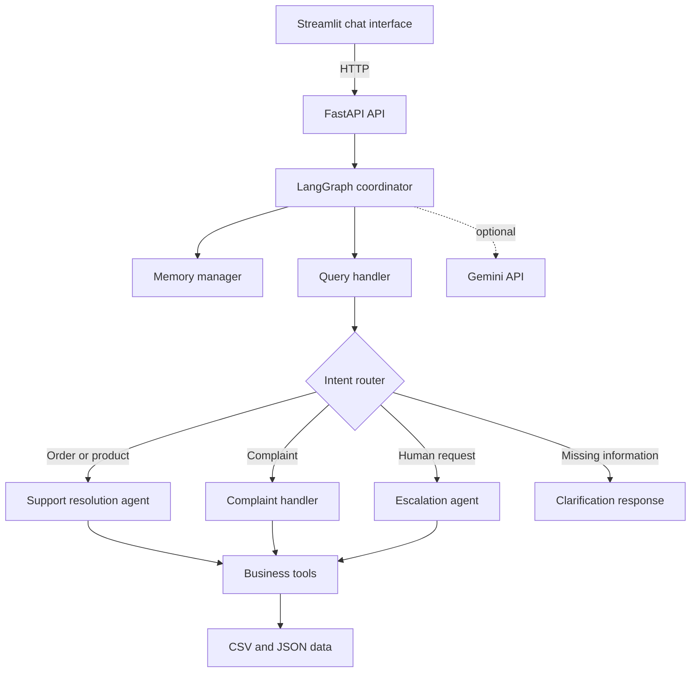

# AI Support Employee

<p align="center">
  
</p>

<p align="center">
  An agentic customer-support application that classifies requests, routes them
  to specialized agents, retrieves trusted business data, remembers context,
  resolves routine issues, and escalates complex cases to a human.
</p>

## Table of Contents

- [Overview](#overview)
- [Key Features](#key-features)
- [Architecture](#architecture)
- [How the Workflow Operates](#how-the-workflow-operates)
- [Technology Stack](#technology-stack)
- [Project Structure](#project-structure)
- [Getting Started](#getting-started)
- [Configuration](#configuration)
- [Running the Application](#running-the-application)
- [API Reference](#api-reference)
- [Supported Use Cases](#supported-use-cases)
- [Data and Persistence](#data-and-persistence)
- [Evaluation](#evaluation)
- [Troubleshooting](#troubleshooting)
- [Security and Privacy](#security-and-privacy)
- [Current Limitations](#current-limitations)
- [Project Team](#project-team)
- [License](#license)

## Overview

AI Support Employee is a full-stack proof of concept for automated customer
support. Customers interact through a Streamlit chat interface, while a FastAPI
backend runs a LangGraph workflow that:

1. Loads the customer's previous conversation context.
2. Classifies the request and extracts useful entities.
3. Routes the request to the appropriate specialist agent.
4. Uses local business tools to retrieve or update trusted data.
5. Resolves the request, asks for clarification, or escalates it.
6. Returns a structured response and saves the interaction to memory.

Gemini can improve intent classification and response wording when a valid API
key is configured. The application also includes a deterministic rule-based
fallback, so its core workflows remain available without an API key.

## Key Features

- **Agentic orchestration:** LangGraph coordinates memory loading, intent
  classification, routing, specialist agents, final decisions, and persistence.
- **Specialized agents:** Separate handlers manage general queries, order and
  product support, complaints, escalation, and conversation memory.
- **Hybrid intelligence:** Uses the Gemini API when available and falls back to
  deterministic local logic when it is unavailable.
- **Grounded responses:** Order, product, and complaint facts are retrieved from
  local data tools rather than invented by the language model.
- **Conversation memory:** Follow-up questions can reuse context from previous
  turns for the same customer.
- **Complaint management:** Creates complaint records, detects existing cases,
  assigns priority, and applies escalation rules.
- **Human escalation:** Supports explicit human requests and automatic
  escalation for delayed, urgent, or repeated issues.
- **Customer-data isolation:** Order lookups verify that an order belongs to the
  requesting customer before returning its details.
- **REST API:** FastAPI exposes chat, order, complaint, and memory endpoints with
  automatically generated OpenAPI documentation.
- **Operational dashboard:** The Streamlit interface displays the selected
  intent, confidence, agent, tool, pipeline, retrieved data, and final decision.
- **Reproducible evaluation:** A labeled test suite measures intent accuracy,
  escalation accuracy, data integrity, and tool correctness.

## Architecture



### Application Layers

| Layer | Responsibility |
|---|---|
| Streamlit GUI | Chat input, example prompts, backend status, metadata, and workflow visualization |
| FastAPI | Request validation, HTTP endpoints, response serialization, and OpenAPI documentation |
| LangGraph | Stateful workflow orchestration and conditional routing |
| Agents | Intent handling, support resolution, complaints, escalation, and memory management |
| Tools | Controlled access to order, product, complaint, and memory data |
| Data | CSV files for business records and JSON for conversation history |
| Gemini | Optional classification, reasoning assistance, and response polishing |

For a more detailed technical description, see
[`report/architecture.md`](report/architecture.md).

## How the Workflow Operates

```text
START
  -> load_memory
  -> query_handler
  -> route_request
       -> support_resolution
       -> complaint_handler
       -> escalation_agent
       -> clarification
  -> final_decision
  -> update_memory
END
```

### Agent Responsibilities

| Agent | Purpose |
|---|---|
| Query Handler | Classifies intent, extracts entities, and restores relevant context from memory |
| Support Resolution | Handles order tracking and product-information requests |
| Complaint Handler | Validates orders, creates complaints, finds existing complaints, and applies escalation rules |
| Escalation Agent | Produces a human handoff decision and an internal support summary |
| Memory Manager | Loads and stores customer-specific conversation history |

### Recognized Intents

- `order_tracking`
- `product_info`
- `complaint`
- `escalation`
- `clarification`
- `unknown`

## Technology Stack

| Category | Technology |
|---|---|
| Language | Python 3.10+ |
| API framework | FastAPI |
| ASGI server | Uvicorn |
| User interface | Streamlit |
| Agent orchestration | LangGraph |
| Generative AI | Google Gemini through `google-genai` |
| Data processing | Pandas |
| Validation | Pydantic |
| Configuration | `python-dotenv` |
| HTTP client | Requests |
| Storage | CSV and JSON files |

## Project Structure

```text
ai_support_employee/
|-- app/
|   |-- agents/
|   |   |-- complaint_handler.py
|   |   |-- escalation_agent.py
|   |   |-- memory_manager.py
|   |   |-- query_handler.py
|   |   `-- support_resolution.py
|   |-- data/
|   |   |-- complaints.csv
|   |   |-- memory.json
|   |   |-- orders.csv
|   |   `-- products.csv
|   |-- tools/
|   |   |-- complaint_tool.py
|   |   |-- memory_tool.py
|   |   |-- order_tool.py
|   |   `-- product_tool.py
|   |-- config.py
|   |-- gemini_client.py
|   |-- graph.py
|   |-- main.py
|   `-- schemas.py
|-- assets/
|   |-- logo.png
|   `-- logo.svg
|-- gui/
|   `-- streamlit_app.py
|-- report/
|   |-- architecture.md
|   |-- evaluation.py
|   `-- evaluation_results.json
|-- .env.example
|-- requirements.txt
`-- README.md
```

> The local `venv/` directory is a development environment and should normally
> be excluded from version control.

## Getting Started

### Prerequisites

- Python 3.10 or later
- `pip`
- A Gemini API key, optional
- Two available local ports: `8000` for FastAPI and `8501` for Streamlit

### 1. Open the Project Directory

```powershell
cd \path\to\ai_support_employee
```

On macOS or Linux, change into the directory where the repository was cloned:

```bash
cd /path/to/ai_support_employee
```

### 2. Create a Virtual Environment

Windows PowerShell:

```powershell
python -m venv venv
.\venv\Scripts\Activate.ps1
```

Windows Command Prompt:

```bat
python -m venv venv
venv\Scripts\activate.bat
```

macOS or Linux:

```bash
python3 -m venv venv
source venv/bin/activate
```

### 3. Install Dependencies

```bash
python -m pip install --upgrade pip
pip install -r requirements.txt
```

### 4. Configure Environment Variables

Windows PowerShell:

```powershell
Copy-Item .env.example .env
```

Windows Command Prompt:

```bat
copy .env.example .env
```

macOS or Linux:

```bash
cp .env.example .env
```

Edit `.env` and provide a Gemini API key if you want model-assisted behavior:

```dotenv
GEMINI_API_KEY=your_gemini_api_key_here
GEMINI_MODEL=gemini-2.5-flash
API_BASE_URL=http://127.0.0.1:8000
```

Create a Gemini API key in
[Google AI Studio](https://aistudio.google.com/apikey). The configured model
must be available to your account. If the key is missing or a model request
fails, the application automatically uses its rule-based fallback.

## Configuration

| Variable  | Default in application | Description |
|---:|---|---|
| `GEMINI_API_KEY`  | `your_gemini_api_key_here` | Enables Gemini-backed classification and response polishing |
| `GEMINI_MODEL`  | `gemini-2.5-flash` | Gemini model used by the client |
| `API_BASE_URL` | `http://127.0.0.1:8000` | Backend URL used by the Streamlit interface |

Do not commit a populated `.env` file or expose API keys in screenshots, logs,
or source control.

## Running the Application

Run all commands from the project root so Python can resolve the `app` package.

### Start the FastAPI Backend

```bash
uvicorn app.main:app --reload
```

The backend is then available at:

- API root: <http://127.0.0.1:8000>
- Swagger UI: <http://127.0.0.1:8000/docs>
- ReDoc: <http://127.0.0.1:8000/redoc>
- OpenAPI schema: <http://127.0.0.1:8000/openapi.json>

### Start the Streamlit Interface

Open a second terminal, activate the same virtual environment, and run:

```bash
streamlit run gui/streamlit_app.py
```

The interface is normally available at <http://localhost:8501>.

### Run on Different Ports

```bash
uvicorn app.main:app --reload --port 8001
```

When changing the API port, update `.env` before starting Streamlit:

```dotenv
API_BASE_URL=http://127.0.0.1:8001
```

## API Reference

### Endpoint Summary

| Method | Endpoint | Description |
|---|---|---|
| `GET` | `/` | Returns service status, active model, Gemini availability, and endpoint information |
| `POST` | `/support/chat` | Runs the complete support workflow for a customer message |
| `GET` | `/orders/{customer_id}` | Returns all orders belonging to a customer |
| `GET` | `/complaints/{customer_id}` | Returns authorized complaint records for a customer |
| `DELETE` | `/memory/{customer_id}` | Clears stored conversation memory for a customer |

### Send a Support Message

Request:

```http
POST /support/chat
Content-Type: application/json
```

```json
{
  "customer_id": "CUST-02",
  "message": "Where is my order ORD-1002?"
}
```

Example with `curl`:

```bash
curl -X POST "http://127.0.0.1:8000/support/chat" \
  -H "Content-Type: application/json" \
  -d "{\"customer_id\":\"CUST-02\",\"message\":\"Where is my order ORD-1002?\"}"
```

Example with PowerShell:

```powershell
$body = @{
    customer_id = "CUST-02"
    message = "Where is my order ORD-1002?"
} | ConvertTo-Json

Invoke-RestMethod `
    -Method Post `
    -Uri "http://127.0.0.1:8000/support/chat" `
    -ContentType "application/json" `
    -Body $body
```

Representative response:

```json
{
  "customer_id": "CUST-02",
  "intent": "order_tracking",
  "agent": "support_resolution",
  "action": "order_status_provided",
  "message": "Your order ORD-1002 is currently 'In Transit'.",
  "tool_used": "order_tool",
  "data": {
    "order_id": "ORD-1002",
    "customer_id": "CUST-02",
    "product_id": "P-102",
    "status": "In Transit",
    "delivery_date": "2026-06-18",
    "shipping_city": "Jeddah",
    "last_update": "Package is with courier",
    "found": true,
    "belongs_to_customer": true
  },
  "escalated": false,
  "escalation_reason": null,
  "memory_updated": true,
  "confidence": 0.85,
  "entities": {
    "order_id": "ORD-1002"
  },
  "pipeline": [
    "load_memory",
    "query_handler",
    "route_request",
    "support_resolution",
    "final_decision",
    "update_memory"
  ]
}
```

### List Customer Orders

```bash
curl "http://127.0.0.1:8000/orders/CUST-02"
```

### List Customer Complaints

```bash
curl "http://127.0.0.1:8000/complaints/CUST-01"
```

### Clear Customer Memory

```bash
curl -X DELETE "http://127.0.0.1:8000/memory/CUST-01"
```

## Supported Use Cases

| Scenario | Example |
|---|---|
| Track an order | `Where is my order ORD-1002?` |
| Retrieve product details | `Tell me about product P-101.` |
| Search by product name | `How much does the Bukhoor Incense Burner cost?` |
| Request missing information | `Where is my order?` |
| Create a complaint | `My order ORD-1012 is wrong, and I want a refund.` |
| Review an existing complaint | `Any update on my complaint about ORD-1003?` |
| Escalate an urgent issue | `Complaint about ORD-1011: my refund is urgent.` |
| Request a human | `I want to speak to a human.` |
| Use remembered context | Ask about an order, then send `Any update?` |

### Escalation Conditions

Complaint and escalation logic can hand a case to a human when:

- The customer explicitly asks for a human agent.
- A related order is marked `Delayed`.
- The issue is classified as high urgency.
- The customer has two or more prior complaints.
- The customer returns with an unresolved urgent complaint.
- The escalation agent receives an unknown or low-confidence request.
- Required information cannot be safely resolved automatically.

## Data and Persistence

### Business Data

The application uses local files under `app/data/`:

| File | Purpose | Access |
|---|---|---|
| `orders.csv` | Order ownership, status, destination, and delivery details | Read-only |
| `products.csv` | Product names, categories, prices, descriptions, and warranties | Read-only |
| `complaints.csv` | Complaint history and newly created complaint records | Read/write |
| `memory.json` | Customer-specific conversation history | Read/write |

### Data Integrity

The language model is not treated as the source of truth for business facts.
Specialized tools retrieve records from the local data files, and generated
responses are instructed to use only those facts.

Order requests also check `customer_id` ownership. If an order exists but
belongs to another customer, the API does not return that order's private
details.

### Development Reset

The evaluation script restores its seeded complaint and memory data when it
finishes. For normal development, make a backup before manually replacing any
file in `app/data/`, because complaints and chat interactions are persisted
directly to those files.

## Evaluation

Run the bundled evaluation from the project root:

```bash
python report/evaluation.py
```

The suite evaluates:

- Intent-classification accuracy
- Escalation-decision accuracy
- Per-intent correctness
- Unknown-order data integrity
- Order and product tool correctness

The checked-in [`report/evaluation_results.json`](report/evaluation_results.json)
records a 27-query run with:

| Metric | Recorded result |
|---|---:|
| Intent accuracy | 100% |
| Escalation accuracy | 100% |
| Macro F1 | 1.00 |
| Data-integrity check | Pass |
| Tool-data correctness | Pass |

These values describe that specific fixture-based evaluation run and should not
be interpreted as production performance. Re-run the evaluation after changing
classification rules, tools, prompts, seed data, or model configuration.

## Troubleshooting

### `ModuleNotFoundError: No module named 'app'`

Run Uvicorn, Streamlit, and the evaluation script from the project root.

### Streamlit Reports That the Backend Is Offline

1. Confirm that Uvicorn is running.
2. Open <http://127.0.0.1:8000> in a browser.
3. Verify that `API_BASE_URL` matches the backend host and port.
4. Restart Streamlit after changing `.env`.

### Gemini Is Disabled

Check that:

- `GEMINI_API_KEY` is set in `.env`.
- The `google-genai` dependency is installed.
- The configured `GEMINI_MODEL` is available to the API key.
- The machine can reach the Gemini API.

The application will continue in rule-based fallback mode when Gemini is not
available.

### Gemini Returns a Model Error

Set `GEMINI_MODEL` to a model enabled for your account. The application's code
default is `gemini-2.5-flash`; the value in `.env` takes precedence.

### Complaints or Memory Are Not Saved

Ensure that the current user can write to:

- `app/data/complaints.csv`
- `app/data/memory.json`

Also confirm that neither file is locked by another program.

### Port Is Already in Use

Start the backend on another port and update `API_BASE_URL`:

```bash
uvicorn app.main:app --reload --port 8001
```

### PowerShell Blocks Virtual-Environment Activation

For the current PowerShell session:

```powershell
Set-ExecutionPolicy -Scope Process -ExecutionPolicy Bypass
.\venv\Scripts\Activate.ps1
```

## Security and Privacy

- Keep `.env` and API credentials out of version control.
- Use HTTPS and authentication before exposing the API outside a trusted local
  environment.
- Treat customer IDs, orders, complaints, and conversation history as sensitive
  data.
- Replace file-based persistence with an access-controlled database for
  production use.
- Add authorization checks at the API boundary; the current customer ID is
  supplied by the caller and is not backed by an authentication system.
- Configure retention and deletion policies for `memory.json` and complaints.
- Avoid logging full customer messages or model prompts in production.
- Validate and rate-limit public requests to reduce abuse and resource usage.

## Current Limitations

- Persistence uses local CSV and JSON files, which are not designed for
  concurrent production workloads.
- The API does not currently implement authentication or role-based access.
- Human escalation creates a structured handoff response but does not connect
  to an external ticketing or contact-center platform.
- The rule-based classifier is optimized for the included English examples.
- There is no automated unit-test directory; the provided evaluation script is
  the primary regression check.
- Dependency versions in `requirements.txt` are not pinned.
- Deployment configuration for containers or cloud platforms is not included.


